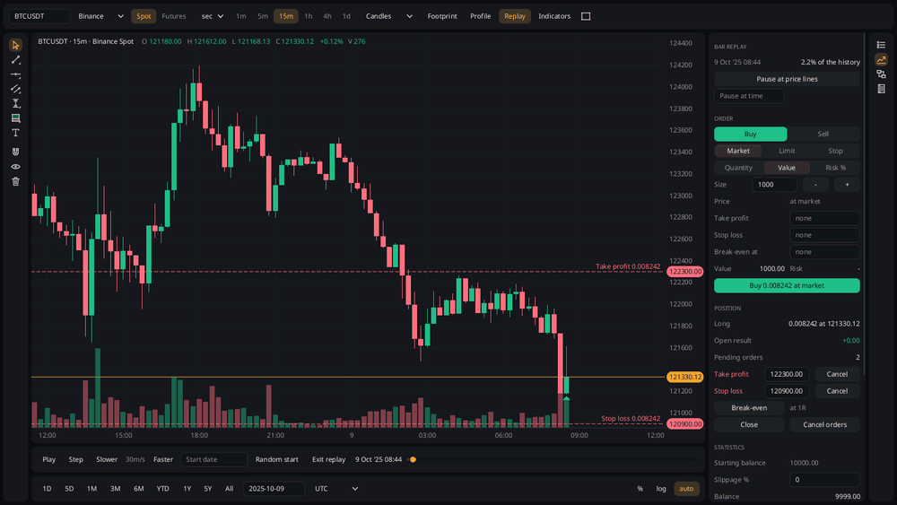
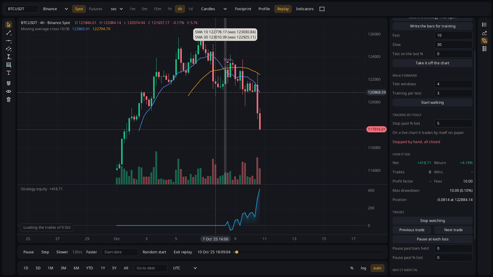
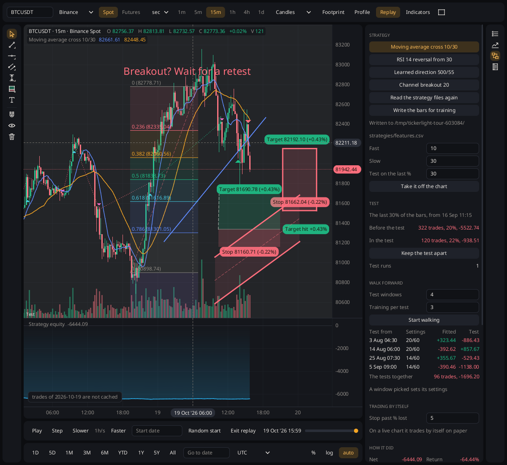
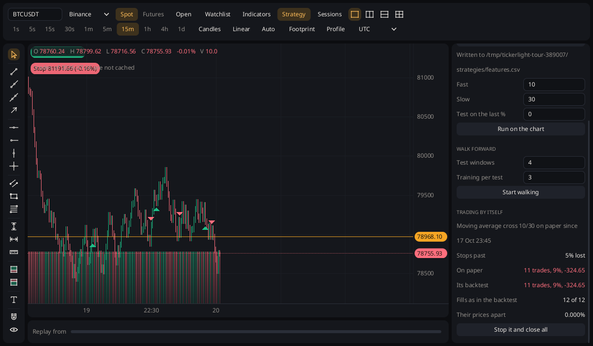

# Tickerlight

**Free, local charting, replay and strategy platform.** See every tick. Never the next one.



Tickerlight is a desktop program for charts, bar replay and strategies. It is free and open source, and it runs
on your machine: the market data and everything you do stay there. It is built in Rust on its own charting
engine and drawn on the GPU. If it is of use to you, it can be [supported](#support).

## What sets it apart

- **A free manual backtest that cannot look ahead.** Replay any market bar by bar or tick by tick and trade it
  with market, limit and stop orders, take profit, stop loss and break-even. Everything stops at the replay
  cursor, by construction: the indicators, the footprint and volume profile from trades, and the strategies.
- **Watch a strategy or a model trade.** Its trades are replayed one after another, from a little before each entry
  to its exit, so a wrong entry is seen, understood and fixed.
- **Train, test and trade with the same code.** A strategy or a model is backtested on the chart, tested on bars
  kept apart, walked forward, and traded on paper on a live chart beside its own backtest of the same bars.

| | |
| --- | --- |
|  |  |
| Watching a strategy trade | A test period kept apart, a walk forward |



## What is in it

- Candles, Heikin-Ashi, bars, line and area; linear, log and percent scales; up to four charts in a window, synced.
- 17 drawing tools (lines, rays, channel, rectangle, Fibonacci retracement, ranges, long and short positions,
  text notes) with styles, magnet, lock and undo.
- 18 indicators: SMA, EMA, WMA, VWAP, Bollinger, Donchian, RSI, MACD, ATR, Stochastic, OBV, CCI, MFI, ADX,
  SuperTrend, pivots, volume, Ichimoku; trading sessions.
- Order flow: footprint and volume profile from the trades, cut by the replay too.
- Bar replay down to bars of seconds, replay stops, a trade journal with notes, tags and pictures, statistics and
  an equity curve, sessions kept between runs.
- Strategies: built-in ones, your own written in Rust and built to WebAssembly (no rebuild of the program), and
  models trained elsewhere as ONNX files.
- Paper trading on live data, by hand or by a strategy.
- Data with no account or key: Binance, OKX, Coinbase, KuCoin, Bitget, Kraken, Bitstamp, Bitfinex and Deribit
  (crypto, spot and perpetual futures), Dukascopy (forex, metals, indices, stock and commodity CFDs), and CSV files
  of candles or trades.

Status: early.

## Run it

Download the archive for your system from [Releases](https://github.com/tickerlight/tickerlight/releases)
(on a Mac: `aarch64-apple-darwin` for Apple silicon, `x86_64-apple-darwin` for Intel), unpack it and run
`tickerlight` (`tickerlight.exe` on Windows). The builds are not signed yet:

- Windows: on "Windows protected your PC", click "More info", then "Run anyway".
- macOS: run `xattr -d com.apple.quarantine tickerlight` in the unpacked folder once, or after the first refusal
  allow it in System Settings, Privacy & Security, "Open Anyway".

A symbol can be given at the start (`tickerlight ETHUSDT --futures --months 3` opens the USD-M futures with three
months of history); with none it opens where it was left, else BTCUSDT.

From source, with [Rust](https://rustup.rs) (the version in `rust-toolchain.toml` is installed by `rustup` on
the first build):

```sh
git clone https://github.com/tickerlight/tickerlight && cd tickerlight
cargo run --release -p tickerlight-app
```

It draws with Vulkan, Metal, DirectX 12 or OpenGL. The first start downloads the history of the symbol (each
finished month or day once) and then follows it live.

The data folder holds the downloaded history, the sessions, the drawings and the strategy files:

| System | Folder |
| --- | --- |
| Linux | `~/.local/share/tickerlight` |
| macOS | `~/Library/Application Support/tickerlight` |
| Windows | `%APPDATA%\tickerlight` |

`TICKERLIGHT_DATA_DIR` puts it elsewhere.

In the program the panels do most things; the keys: `R` replay (at the pointer), `Space` play/pause, `→` step,
`↑`/`↓` speed. Drawings: `H` horizontal line, `D` trend line, `Z` rectangle, `V` vertical line, `G` Fibonacci,
`M` ruler, `Esc` cancel, `Delete` remove the selected, `Ctrl+Z`/`Ctrl+Shift+Z` undo/redo. `K` cycles the series
kind, `O` the price scale (linear / log / percent), `F` the timeframe (a replay on 15 minutes still moves one
minute at a time, the newest candle forms in front of you). Drag to pan, wheel to zoom; drag or wheel on a price
axis to scale it by hand (`A` autoscales again); drag a pane separator to resize. Touch: one finger drags, two
fingers pinch to zoom. Trading is done from the order panel; drag an order line to move it.

## Strategies and models

- [Writing a strategy](docs/strategies.md): Rust built to WebAssembly, loaded from the data folder.
- [Training a model elsewhere](docs/models.md): the bars written out as features, a model trained in Python and
  exported to ONNX.
- In the program's own code: a strategy implements `Strategy` (`crates/core/src/builtin/strategy.rs`);
  `MovingAverageCross` and `RsiReversal` there are examples, and the program's list is `strategies()` in
  `crates/app/src/program.rs`.

## Building on it

| Crate | What |
| --- | --- |
| `tickerlight-core` | Data (columnar candles and trades), scales, the plugin API, all built-in features (drawings, indicators, replay, trading, strategies). No GPU, no I/O. |
| `tickerlight-backend-wgpu` | Draws a `Scene` with wgpu; the window loop (winit); headless rendering to PNG. |
| `tickerlight-text` | The font (Noto Sans, the system's fonts for what it lacks) and the glyph atlas. |
| `tickerlight-ui` | Controls drawn into the chart's scene: a small immediate-mode widget kit, a window of panels docked around the chart, and the panels. |
| `tickerlight-app` | The program, `tickerlight`: the local cache, live data, the watchlist, the pages, sessions kept between runs. |
| `tickerlight-binance`, `-okx`, `-coinbase`, `-kucoin`, `-bitget`, `-kraken`, `-bitstamp`, `-bitfinex`, `-deribit`, `-dukascopy` | Data sources: history and live streams. Not part of the core. |
| `tickerlight-strategy`, `tickerlight-wasm` | Strategies built to WebAssembly: what they are written with, and the sandbox that runs them. |
| `tickerlight-onnx` | Models trained elsewhere, run as strategies. |
| `tickerlight-web` | An early browser build, not developed (kept building only). |

```sh
# Headless, as PNGs: every step of using the program; the window in use; footprint and volume profile
TICKERLIGHT_DATA_DIR=... cargo run -p tickerlight-app --example tour -- out/
TICKERLIGHT_DATA_DIR=... cargo run -p tickerlight-app --example panels -- out.png
TICKERLIGHT_DATA_DIR=... cargo run -p tickerlight-app --example flow -- out.png
# Random data in a window; PNGs of scripted sessions; frame times on 1M candles
cargo run --release -p tickerlight-backend-wgpu --example window
cargo run -p tickerlight-backend-wgpu --example snapshot -- out/
cargo run --release -p tickerlight-core --example bench
cargo test --workspace
```

See [CONTRIBUTING.md](CONTRIBUTING.md) before sending a change.

A plugin adds layers (draw), handlers (react to input), resources (shared state), commands, keys and buttons.
See [`crates/core/examples/plugin.rs`](crates/core/examples/plugin.rs): a complete one in 80 lines. Layers go to a
pane (`add_layer_in(Panes::One("rsi"), ..)`) and get their own price scale there. Anything built in can be
replaced by adding a layer or handler of the same name, or removed. A chart without the program's panels also
trades by keys: `B`/`S` market buy/sell, `C` close, `L`/`T` limit/stop order at the pointer, `X` cancel orders,
`]`/`[` the order size. Live data is a `Source` (`poll` on every tick); see `tickerlight-binance` for a WebSocket
one.

## Support

Tickerlight is free and stays free. If it is useful to you, a donation helps keep it going. Send each coin only on
the network named for it: coins sent on another network are lost.

| Coin | Network | Address |
| --- | --- | --- |
| Bitcoin | Bitcoin | `bc1qvz6s39gntsja9zltmyvdllc5fmqaa9mfvwdyd6` |
| Bitcoin | Lightning | `jauntytwig6793@cake.cash` |
| ETH, USDT, USDC | Ethereum and EVM networks (Arbitrum, Base, Optimism, Polygon, BNB Chain) | `0xBEff04d313931F931B54d5A2e99beD131398E289` |
| SOL, USDT, USDC | Solana | `Ev31Ekz4mxFptCPVrxfGSMKfzz6N4QiBN8z28G4ed7me` |
| TRX, USDT | Tron (TRC-20) | `TAiL2Abj2PnmNLTwARtBwVLvbtdgZ1q2qQ` |
| XMR | Monero | `45quWxug36w1poVggRcMGp26fgtaXL1d9fRXK3XuaFv1TeA5zMeABKRQUDk7BEpZkmfmNAjo2f7yzhqP8TCzcFA1PAA7tgZ` |

## Data and trading

Tickerlight is not affiliated with or endorsed by any exchange or data provider. It downloads market data from
their public archives and APIs straight to your machine, for your own use, under each provider's terms (Binance's
historical archive, for one, is licensed by Binance Vision under CC BY-NC-SA 4.0 for non-commercial use);
nothing is redistributed with the program. Nothing in it is financial advice, and results on past data or on
paper do not promise results with money.

## License

MIT or Apache 2.0, at your option: [LICENSE-MIT](LICENSE-MIT), [LICENSE-APACHE](LICENSE-APACHE). Unless you
explicitly state otherwise, any contribution intentionally submitted for inclusion in the work by you, as defined
in the Apache-2.0 license, shall be dual licensed as above, without any additional terms or conditions.
